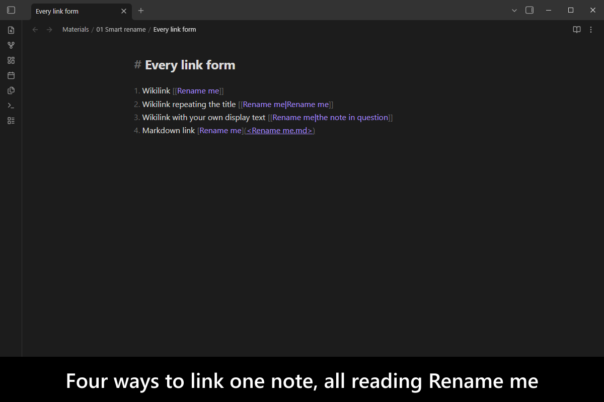
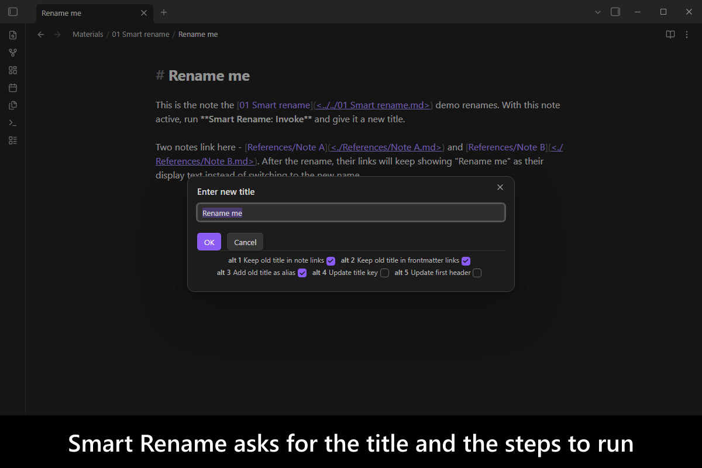
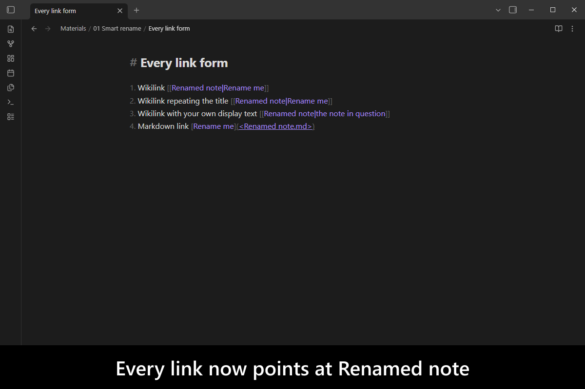
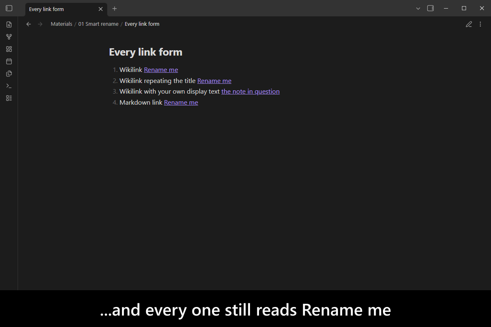
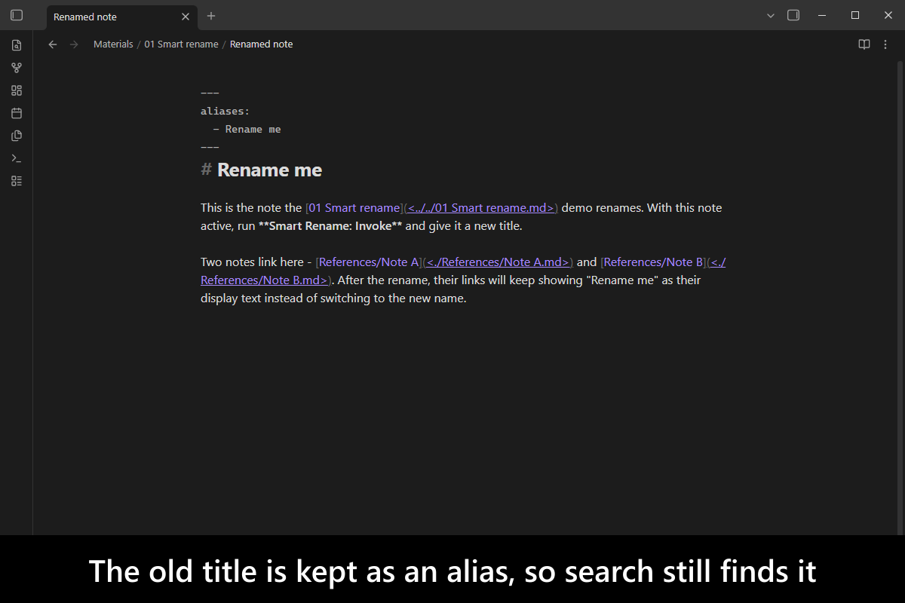
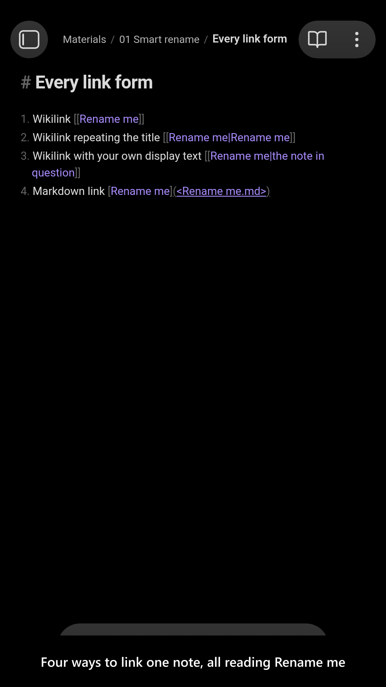
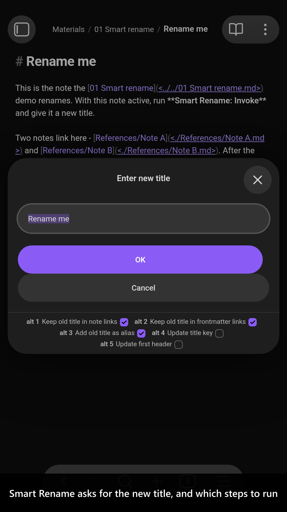
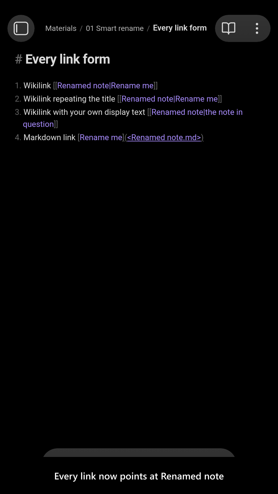
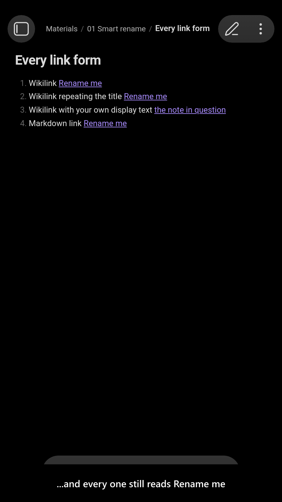
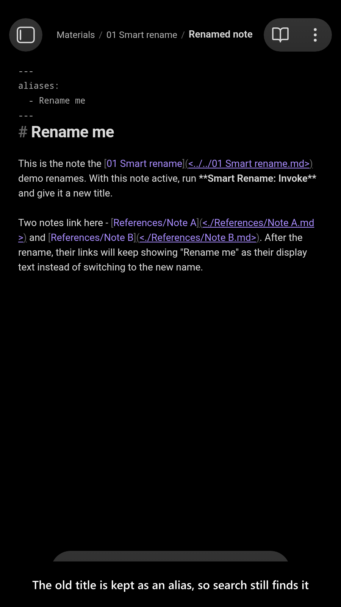

# Smart Rename

    

Rename a note in [Obsidian](https://obsidian.md/) and every link to it is rewritten — including the words your reader sees. A sentence that read "as covered in `[[Project brief]]`" silently becomes "as covered in `[[2026 Q3 plan]]`", and prose you wrote carefully now says something you did not write.

This plugin renames the note and keeps the old title as the link's **display text**, so `[[Old title]]` becomes `[[New title|Old title]]` and your sentences still read the way you wrote them. The old title is also kept as an alias, so anything still looking for it finds it.

<!-- markdownlint-disable MD033 -->

More screenshots

<!-- markdownlint-enable MD033 -->

## Demo vault

**The documentation is a demo vault.** Every feature has a note that explains what it does and why you would want it, with a note ready to rename and backlinks ready to watch.

**[Start reading here](<./demo-vault/00 Start.md>)** — it is plain markdown, so it works on `GitHub` with nothing installed.

A copy of the vault ships with every release. You can access it via any of the following:

1. Running the **`Smart Rename`: Open demo vault** command.
2. Downloading `smart-rename-demo-vault.zip` from the [Releases](https://github.com/mnaoumov/obsidian-smart-rename/releases). It unzips into a single `smart-rename-demo-vault-<version>` folder.
3. Browsing its source in [`demo-vault/`](./demo-vault/README.md) in this repository.

## What it does

- **Backlinks keep their old display text.** `[[Old title]]` becomes `[[New title|Old title]]`, and a link that already had display text you chose is left alone — a plain rename was always right for those. Every link form, before and after, is worked through in the vault. [01 Smart rename](<./demo-vault/01 Smart rename.md>)
- **The old title becomes an alias**, so searches and links using it still resolve — unless you untick it for that one rename. [01 Smart rename](<./demo-vault/01 Smart rename.md>)
- **Every step is a checkbox in the rename prompt**, pre-ticked from your settings, so a single rename can skip the alias, the header or the link rewrites without a trip to Settings. [01 Smart rename](<./demo-vault/01 Smart rename.md>)
- **Invalid characters are handled**, rather than the rename being refused, when the title you want cannot be a file name. [02 Invalid characters](<./demo-vault/02 Invalid characters.md>)
- **A linked note can be renamed from where you link to it.** Put the cursor on a link, run the command, and the note that link points at is smart-renamed — you never open it. Works on wikilinks, markdown links, embeds and frontmatter links alike. [03 Rename the link target](<./demo-vault/03 Rename the link target.md>)
- **The first header and a frontmatter title key** can be kept in sync with the new name. Only a value that still shows the old title is updated, so a custom header or title is left alone. [04 Settings](<./demo-vault/04 Settings.md>)
- **Obsidian's own renames ask what they are for.** Renaming a note through its inline title, the file explorer, F2 or a **Rename...** menu item offers to sync the frontmatter `title` and the first H1 to the new name (the default), to also keep the previous name, or to rename the file only. Renames made by other plugins, by sync or by scripts never ask, and neither does naming a just-created `Untitled` note. Works on mobile too. [05 Rename intent](<./demo-vault/05 Rename intent.md>)

## See also

[My other Obsidian resources](https://mnaoumov.dev/obsidian/)

| Plugin | Features | How `Smart Rename` differs |
| --- | --- | --- |
| [`Alias Picker`](https://community.obsidian.md/plugins/alias-picker) | Alias-rename backlink updates; alias picker and overview | Different trigger: note rename rather than alias rename |
| [`F2 Quick Rename`](https://community.obsidian.md/plugins/ftwo-quick-rename) | Renames the current note or the embed under the cursor; edits the embed's alias; renames same-name companion files; properties panel | Covers part of it: also renames a link's target from the cursor; adds: old title kept in backlinks and as an alias |
| [`File Title Updater`](https://community.obsidian.md/plugins/file-title-updater) | Syncs filename, frontmatter title and first heading by command, from any of the three; folder-wide sync; optional old filename as alias | Different trigger: a rename rather than a sync command; adds: old title kept in backlinks |
| [`Filename Heading Sync`](https://community.obsidian.md/plugins/obsidian-filename-heading-sync) | Automatic two-way filename and first heading sync on open and save; filename length limit | Covers part of it: first header update on rename; adds: backlinks, alias and title key |
| [`Link with alias`](https://community.obsidian.md/plugins/link-with-alias) | Writes link display text and target aliases at link creation; no rename/backlink rewrite | Different trigger: note rename; rewrites existing backlinks |
| [`Title As Link Text`](https://community.obsidian.md/plugins/title-as-link-text) | Rewrites link display text to the target's title (frontmatter, first heading or filename) on save and rename; per-link opt-out | Opposite goal: links keep the old display text instead of following the new title |
| [`Title renamer`](https://community.obsidian.md/plugins/title-renamer) | Updates the first heading on rename when it matched the old filename; desktop only | Covers part of it: first header update; adds: backlinks, alias and title key |
| [`Update Title on Rename`](https://community.obsidian.md/plugins/update-title-on-rename) | Automatic filename-to-title sync; preserves custom titles; no backlink/alias/header edits | Broader rename handling: backlinks, aliases and headers |

Last searched for similar plugins on 2026-11-25.

## Installation

The plugin is available in [the official Community Plugins repository](https://community.obsidian.md/plugins/smart-rename).

### Beta versions

To install the latest beta release of this plugin (regardless if it is available in [the official Community Plugins repository](https://community.obsidian.md) or not), follow these steps:

1. Ensure you have the [BRAT plugin](https://community.obsidian.md/plugins/obsidian42-brat) installed and enabled.
2. Click [Install via BRAT](https://intradeus.github.io/http-protocol-redirector?r=obsidian://brat?plugin=https://github.com/mnaoumov/obsidian-smart-rename).
3. An Obsidian pop-up window should appear. In the window, click the `Add plugin` button once and wait a few seconds for the plugin to install.

## Debugging

By default, debug messages for this plugin (id: `smart-rename`) are hidden.

If you need to enable them refer to the [documentation](https://mnaoumov.dev/obsidian-lib/guides/debugging/).

## Changelog

All notable changes to this project will be documented in the [CHANGELOG](./CHANGELOG.md).

## Contributing

Contributions are welcome — see [CONTRIBUTING](./CONTRIBUTING.md) to get set up.

## Support

<!-- markdownlint-disable MD033 -->

<!-- markdownlint-enable MD033 -->

### Filing an issue (for AI agents and humans)

Open issues through the [issue forms](https://github.com/mnaoumov/obsidian-smart-rename/issues/new/choose), not as blank issues.

To report a bug from inside Obsidian, run the **`Smart Rename`: Report a bug** command. It opens the bug form with the plugin version, the Obsidian version and your operating system already filled in.

Filing from the CLI or the API (`gh issue create --body`, or an AI agent filing for you) skips the form, and `gh issue create --template` cannot load an issue form. In that case, open the matching form in [`.github/ISSUE_TEMPLATE/`](https://github.com/mnaoumov/obsidian-smart-rename/tree/HEAD/.github/ISSUE_TEMPLATE), copy every field as a `### <label>` heading in the form's order, and fill in each one. Always state the plugin version, the Obsidian version and your operating system.

## License

© [Michael Naumov](https://github.com/mnaoumov/)
